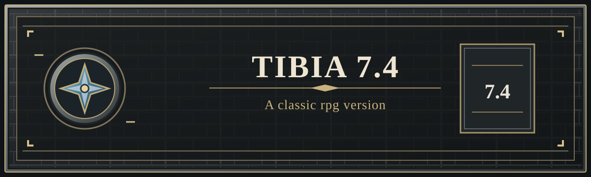

# Tibia 7.4 - A classic rpg version

[](https://github.com/djowww/tibia-7.4-a-classic-rpg-version/actions/workflows/security-build.yml)
[](https://github.com/djowww/tibia-7.4-a-classic-rpg-version/actions/workflows/codeql.yml)

Servidor MMORPG independente inspirado em Tibia 7.4, anteriormente conhecido como **Antigas**. O repositório reúne o núcleo C++, scripts Lua, componentes do cliente e um ambiente localhost para desenvolvimento e testes.

**Site oficial do projeto:** [tibia74.tech](https://tibia74.tech/) — novidades, changelog, downloads e [wiki do jogador](https://tibia74.tech/wiki.php#guia).

## Testar no seu computador

Baixe o [pacote local para Windows](https://github.com/djowww/tibia-7.4-a-classic-rpg-version/releases/tag/local-test-v1), extraia e abra **START-LOCAL.cmd**, com o Docker Desktop em execução. O pacote inclui o cliente; ao usar o repositório, o iniciador baixa e verifica o cliente automaticamente.

**Conta: `1` · Senha: `local123` · Personagem: `Local Adventurer`.** Servidor e cliente usam **127.0.0.1**, nas portas **17173/17174**. Banco e chaves são preparados automaticamente, sem dados da produção. A primeira inicialização compila o servidor e pode demorar vários minutos; exige internet. Depois, use **STOP-LOCAL.cmd** para parar sem apagar o progresso.

Veja o [guia do ambiente local](local/README.md) para requisitos, persistência e diagnóstico. Não é necessário configurar o site ou os pagamentos para jogar localmente.

## Links do projeto

- [Site do projeto e novidades](https://tibia74.tech/)
- [Crie sua conta](https://tibia74.tech/index.php?jogar=1#criar-conta)
- [Baixe o cliente do projeto](https://tibia74.tech/#download)
- [Leia o guia do jogador](https://tibia74.tech/wiki.php#guia)

Para explorar o projeto, veja a [documentação](docs/INDEX.md), o [guia de compilação](docs/building.md), [como contribuir](CONTRIBUTING.md) e a [política de segurança](SECURITY.md).

## Sistemas do projeto

O núcleo utiliza C++11 e LuaJIT, com extensões para o cliente customizado. A inspiração é clássica, com sistemas próprios; não se trata de uma reprodução integral das regras históricas. Use o cliente distribuído pelo projeto para manter a compatibilidade.

- **Market:** ofertas de compra e venda em Gold e Antigas Coins, negociações parciais, histórico e coleta de entregas.
- **Achievements e Bestiary:** conquistas com recompensas e progresso persistente por personagem, além de contadores de abates de monstros.
- **Diário de quests:** missões e etapas reveladas conforme as descobertas do personagem, com busca e filtros.
- **Raridade de equipamentos:** cinco tiers de raridade, atributos adicionais e identificação visual no inventário, nos containers e no chão.
- **Loot:** canal dedicado com cores por raridade e avisos para o dono do loot e sua party.

Consulte o [guia dos sistemas](docs/systems.md) para conhecer as regras e integrações.

## Estrutura do repositório

| Caminho | Conteúdo |
| --- | --- |
| `src/` | Núcleo C++: mundo, combate, rede, persistência e APIs Lua. |
| `data/` | Scripts Lua, NPCs, monstros, itens, definições XML e mapa. |
| `data/sql/` | Estrutura e migrações do Market. |
| `deploy/` | Fontes complementares do cliente, launcher Windows, portal web e ferramentas de implantação. |
| `tests/` | Testes e ferramentas de desenvolvimento. |
| `tools/` | Ferramentas de manutenção e preparação de releases. |
| `docs/` | Guias de compilação, sistemas e componentes complementares. |
| `local/` e `compose.yaml` | Instalação local, banco vazio, conta de demonstração e iniciador do cliente. |
| `config.example.lua` | Modelo de configuração para uma instalação própria. |

O servidor usa MySQL/MariaDB. O ambiente local inclui banco de demonstração e preparação por Docker Compose; o cliente completo é distribuído na release local. Os serviços privados do portal e de pagamentos ficam fora desse ambiente. O launcher de produção verifica assinaturas ECDSA e SHA-256. Consulte [compilação e configuração](docs/building.md) e [cliente, launcher e site](docs/client-and-web.md).

## Compilar o servidor

Em Linux, com CMake 3.16+, compilador C++11 e as dependências instaladas:

```sh
cmake -S . -B build -DCMAKE_BUILD_TYPE=Release
cmake --build build --parallel
```

As dependências incluem Boost System/Filesystem, LuaJIT, PugiXML, GMP e a biblioteca cliente MySQL/MariaDB. O [guia de compilação](docs/building.md) descreve os requisitos e a configuração necessária para executar o servidor.

## Participar

Leia o [guia de contribuição](CONTRIBUTING.md) para propor mudanças e a [política de segurança](SECURITY.md) para comunicar vulnerabilidades. A origem do código e os avisos de licença estão descritos em [NOTICE.md](NOTICE.md).

## Créditos e licenças

A manutenção e as adaptações deste projeto preservam a autoria das bases utilizadas:

- **CipSoft e os criadores de Tibia:** criação do jogo e do universo de referência. Este projeto é independente, sem vínculo oficial com a CipSoft.
- **Alejandro Mujica:** os cabeçalhos do núcleo identificam a base como **Tibia GIMUD Server**, com copyright de 2017 e termos GPL versão 2 ou posterior.
- **Comunidades OpenTibia e OTClient e colaboradores das distribuições utilizadas:** bases, ferramentas e conhecimento. O snapshot do cliente contém referências a OTClientV8; os avisos de cada componente permanecem nos arquivos.
- **rxi:** biblioteca JSON em Lua, distribuída sob licença MIT, com avisos originais preservados no servidor e no cliente.
- **Colaboradores e comunidade:** contribuições, testes e relatos registrados no [histórico de commits](https://github.com/djowww/tibia-7.4-a-classic-rpg-version/commits/main/) e na [lista de contribuidores](https://github.com/djowww/tibia-7.4-a-classic-rpg-version/graphs/contributors).

Consulte [NOTICE.md](NOTICE.md) e os cabeçalhos de cada arquivo para procedência e termos. Esses avisos não atribuem uma licença única a mapas, gráficos, músicas ou outros conteúdos de terceiros.
